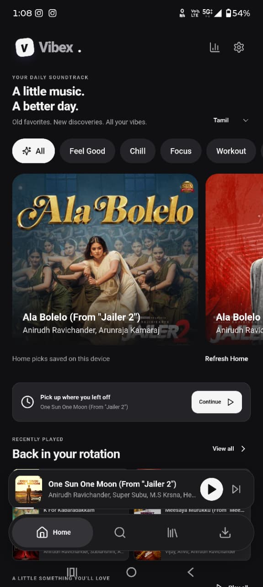
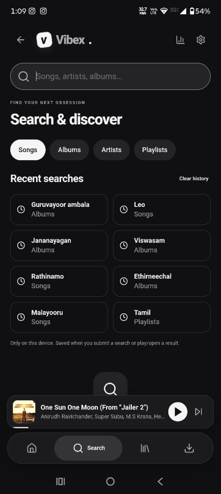
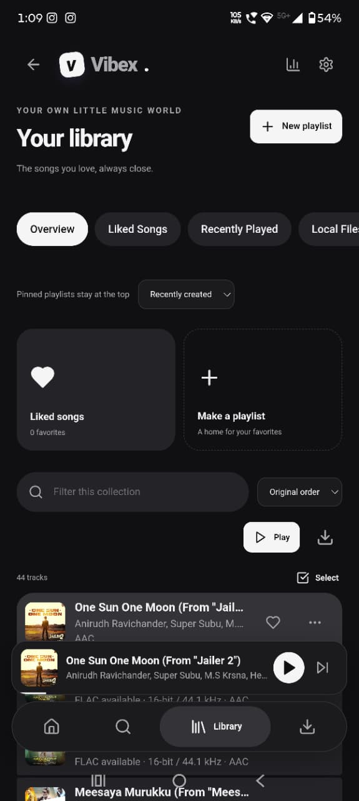
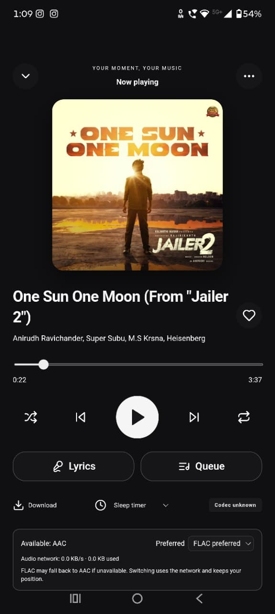
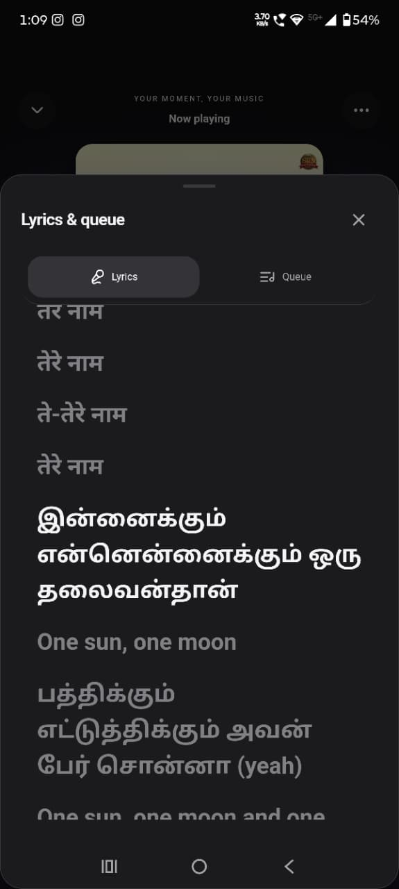

# VIBEX

**An Android music player built with React, Capacitor and native Android Media3.**

[Download latest Android APK](https://github.com/Viswesh28/VIBEX-FLAC-/raw/refs/heads/main/releases/VIBEX-settings-update-v26.apk) · [Versions](#android-test-versions) · [Screenshots](#android-screenshots) · [Build](#build-from-source)

## Android test versions

| Version | What changed | Download |
| --- | --- | --- |
| **v26 — latest** | Updates the Settings About section with current build details and a general note about external services. Includes the v25 artwork fix. | [Download v26 APK](https://github.com/Viswesh28/VIBEX-FLAC-/raw/refs/heads/main/releases/VIBEX-settings-update-v26.apk) · [Notes](docs/release-notes/v26.md) |
| v25 | Makes player artwork visible, uses a darker background and adds a fallback when artwork cannot load. | [Download v25 APK](https://github.com/Viswesh28/VIBEX-FLAC-/raw/refs/tags/v25/releases/VIBEX-artwork-fix-v25.apk) · [Notes](docs/release-notes/v25.md) |

These are **experimental debug builds**, not Play Store releases. Both APKs use the same test signing certificate and application ID (`dev.viswesh.vibex.experimental`), so v26 should install over v25. Installation from outside the Play Store requires Android's permission for your browser or file manager. Back up app data before uninstalling an existing installation.

## Features

- Search music and browse Home, Library and downloads.
- Playback and queue controls, shuffle, repeat and sleep timer.
- Album artwork, timed lyrics when available and a mini-player.
- Playlists, favorites, listening history and backup controls.
- Android Media3 playback, offline downloads and player widget.
- Dark and light themes; lossless playback is attempted where available and may fall back to another format.

Availability depends on the track, connection, external services and device. This project is an Android app; the React interface is hosted inside the Android app using Capacitor. Browser support is useful for development and is not a separate desktop application.

## Android screenshots

Screenshots supplied by the user from an Android phone; visible tracks, artwork and search history are examples. Screens may vary with app version, device and available data.

| Home | Search | Library |
|:---:|:---:|:---:|
|  |  |  |

| Player | Lyrics |
|:---:|:---:|
|  |  |

## Build from source

See [repository setup](REPOSITORY_SETUP.md). You need Node.js, JDK 21 and the Android SDK. The local test signing key is not included. A locally built APK signed with a different key cannot update an installed test APK without uninstalling it first; back up your data before uninstalling.

## Project information

VIBEX is an independent project. Music metadata, artwork, lyrics and audio may be provided by external services. See [license](LICENSE), [notices](NOTICE.md), and [project status](PROJECT_STATUS.md). Screenshots and branding belong to their respective owners. Creator: **VISWESHSARAVAN**.
